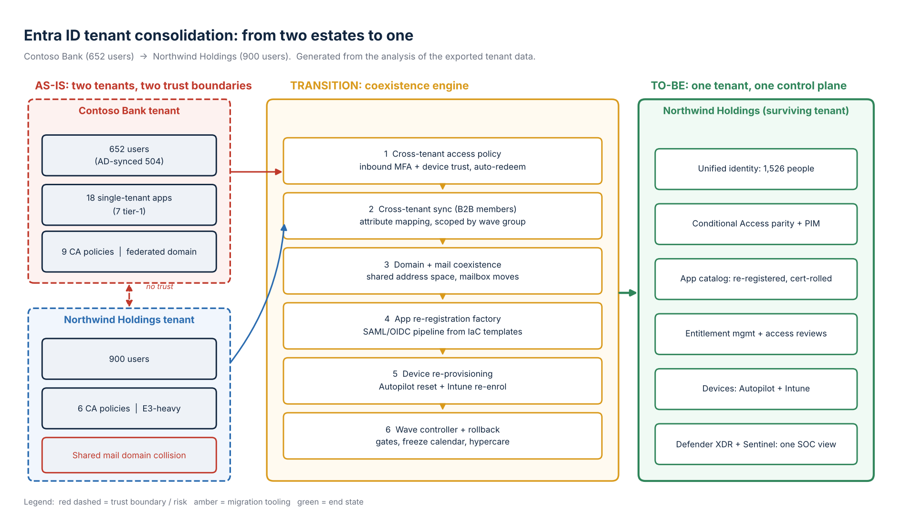
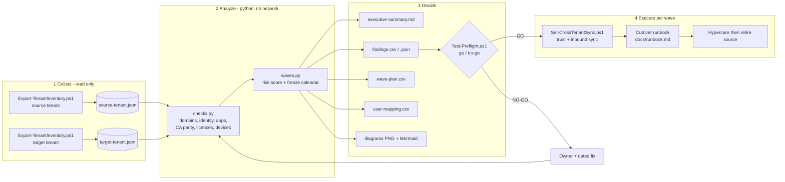
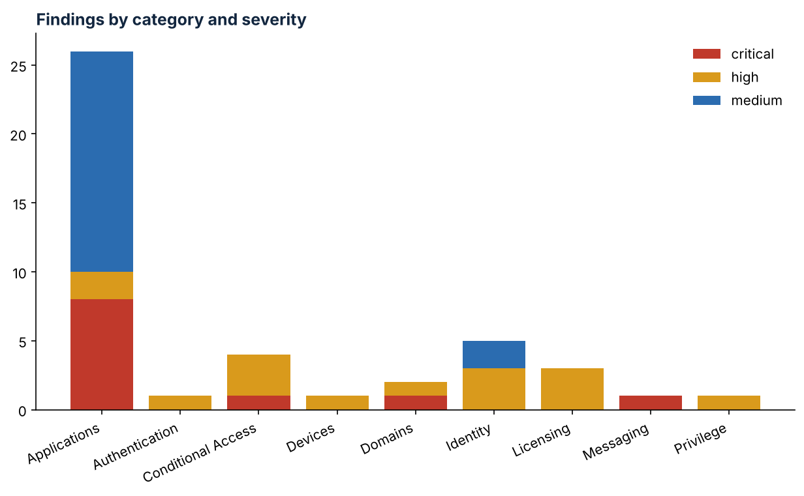
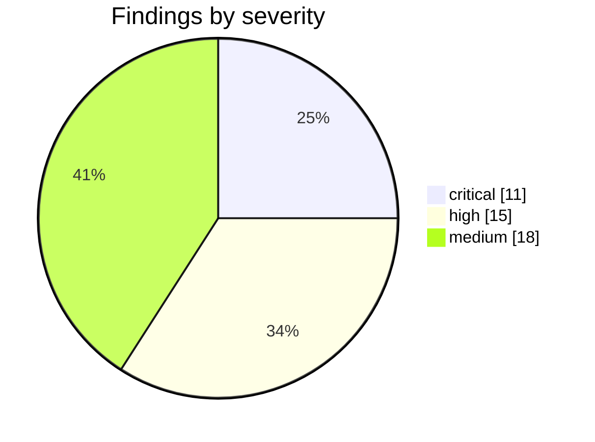
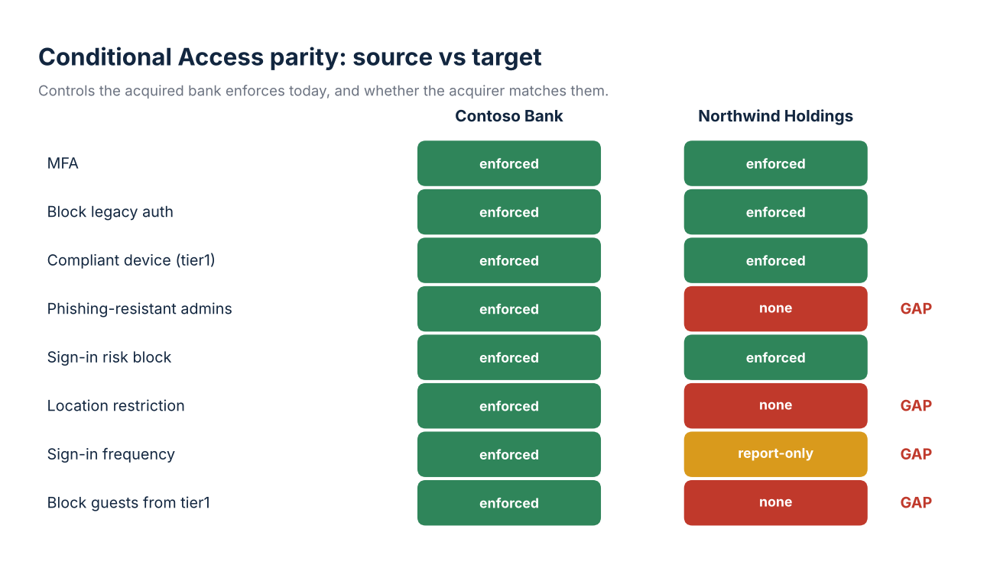
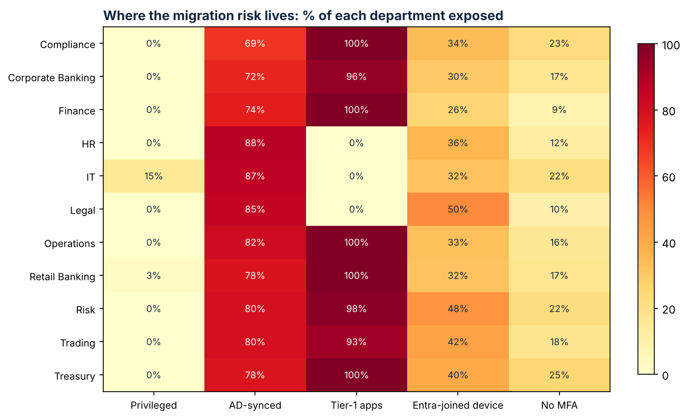
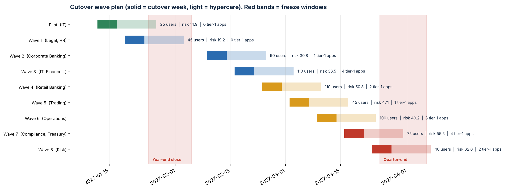
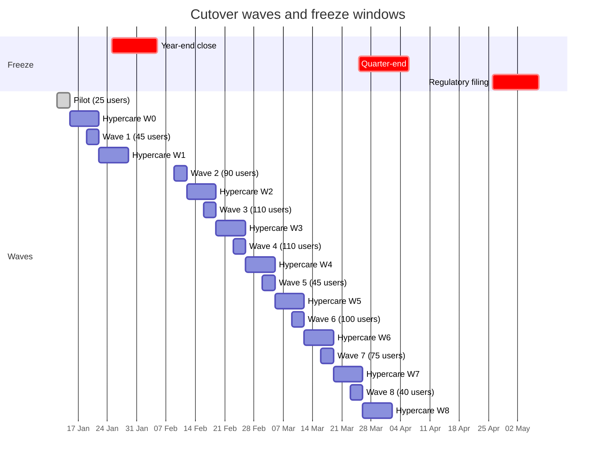
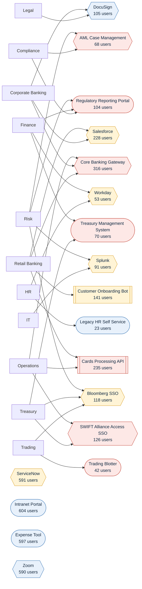
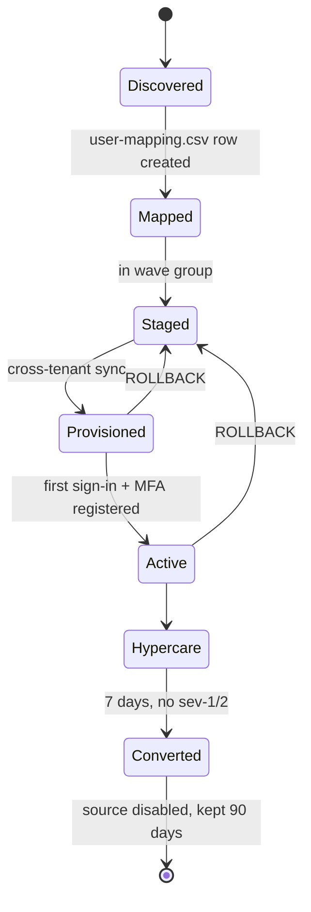

# Entra ID tenant consolidation playbook for mergers

[](https://github.com/Adamson-lab/entra-tenant-consolidation/actions/workflows/analyze.yml)

**The problem:** a merger closes, and the board expects "one company" on day 100. Underneath, two Entra ID tenants hold two sets of identities, two Conditional Access postures, two app estates and often the *same* domain name. Get it wrong and you get a mail outage, a trading desk locked out of its blotter, or a regulator asking why admin MFA vanished.

**What this repo is:** a working toolchain, not a slide deck. It reads exports of both tenants, finds what will break, scores risk per person, builds a freeze-aware wave plan, emits the per-user mapping, and renders the diagrams below from the data. It ships with a seeded fictional merger (Contoso Bank into Northwind Holdings) so every number and picture on this page is reproducible with one command.



## Run it (Windows PowerShell, 30 seconds)

```powershell
git clone https://github.com/Adamson-lab/entra-tenant-consolidation.git
cd entra-tenant-consolidation
.\run.ps1
```

Then open `reports\executive-summary.md` and `reports\diagrams\`. Tests: `python -m unittest discover -s tests -v`.

## How the pipeline works



## What the sample merger reveals

The planner found **44 findings, 11 of them critical**, in the seeded estate. Steering-committee view:






| ID | What breaks | Why an executive cares |
|---|---|---|
| DOM-001 | A mail domain is verified in both tenants | Mail for that namespace cannot move until one side releases it |
| USR-003 | Six SMTP aliases exist in both tenants | Second owner is rejected by Exchange Online; mail goes to the wrong mailbox |
| APP-001 | 7 tier-1 apps are single-tenant (core banking, SWIFT, treasury, trading, AML, regulatory reporting, cards) | Tokens change on migration, the relying party must be updated per app |
| APP-003 | Cards Processing API holds `Directory.ReadWrite.All` | Admin consent does not transfer; unreviewed tenant-wide write access |
| CA-001 | Target has no phishing-resistant admin MFA | Migrated admins would silently lose a regulatory control |
| LIC-002 | E3 seats run out in wave 4, E5 in wave 5 | Hard stop mid-programme unless purchased early |

### Conditional Access parity



### Where the risk concentrates



### Wave plan with freeze windows






### Application dependency map

Departments to the apps they depend on, coloured by criticality (red = tier 1). Hexagons are SAML, rounded are OIDC, double-bordered are API apps.




## Day-of-cutover and rollback



More: [architecture and choreography](docs/architecture.md) (domain move sequence, mail coexistence, control-plane layers, risk quadrant, pattern decision tree), [runbook](docs/runbook.md) (cutover sequence, checklist, rollback by layer), [ADRs](docs/adr).

## Using it on real tenants

1. Install the SDK: `Install-Module Microsoft.Graph -Scope CurrentUser`
2. Export both tenants (read-only scopes), naming your tier-1 apps:
   ```powershell
   .\scripts\powershell\Export-TenantInventory.ps1 -Role source -OutFile data\live\source-tenant.json -Tier1AppNames "Core Banking Gateway","SWIFT Alliance Access SSO"
   .\scripts\powershell\Export-TenantInventory.ps1 -Role target -OutFile data\live\target-tenant.json
   ```
3. Analyze: `$env:PYTHONPATH="src"; py -3 -m tcp --source data\live\source-tenant.json --target data\live\target-tenant.json --out reports`
4. Tune `config/plan.json` (start date, wave cap, freeze windows, risk weights), rerun.
5. Gate: `.\scripts\powershell\Test-Preflight.ps1` (waive with owner and expiry in `config/waivers.json`).
6. Configure trust: `.\scripts\powershell\Set-CrossTenantSync.ps1 -SourceTenantId <guid> -WhatIf`, then without `-WhatIf`.

`data/live/` is git-ignored so real tenant data never reaches GitHub.

## Honest status

- The Python analyzer, planner, diagrams and tests are executed in CI on the sample estate.
- The PowerShell scripts target Microsoft Graph PowerShell and the cross-tenant access REST API. They have not been run against a live tenant in this repo's CI, so pilot them in a non-production tenant first and use `-WhatIf`.
- The sample data is fictional. Findings on a real tenant will differ.

## Layout

```
src/tcp/            analyzer (checks, waves, diagrams, cli)
scripts/powershell/ live export, cross-tenant trust, go/no-go gate
config/             plan.json (waves, freezes, weights), waivers.json
data/sample/        seeded fictional merger
reports/            generated outputs and diagrams (committed so GitHub shows them)
docs/               architecture, runbook, ADRs
tests/              unit tests
.github/workflows/  CI
```
