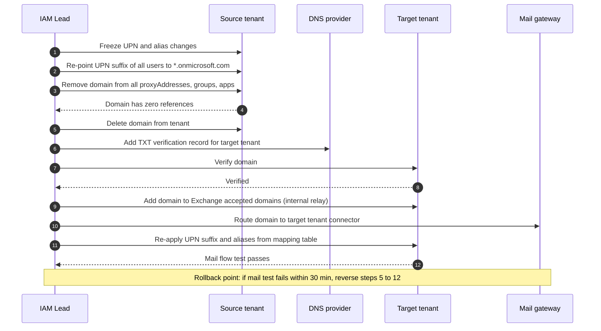
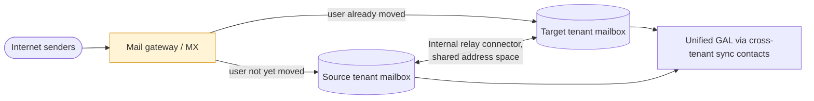
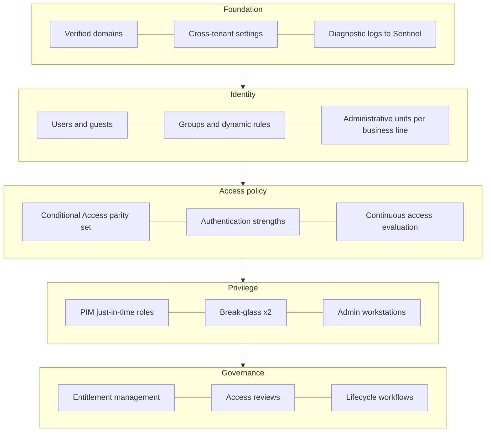
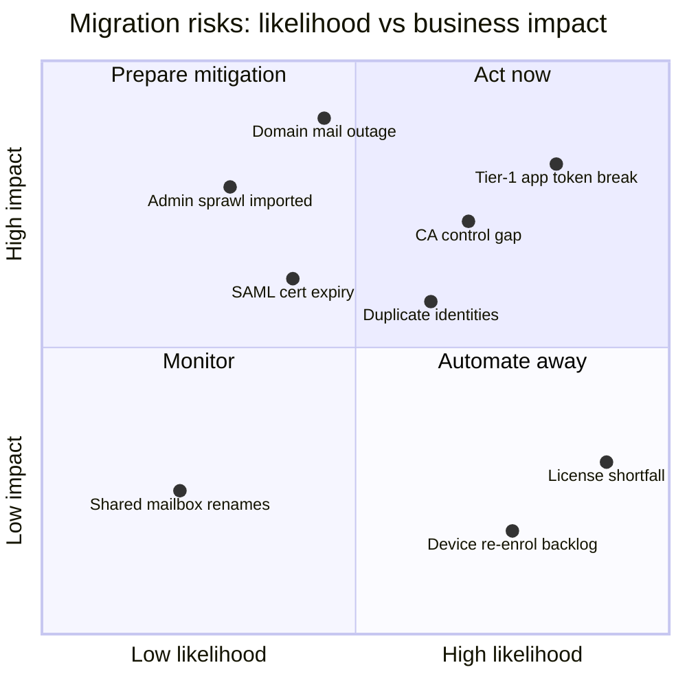
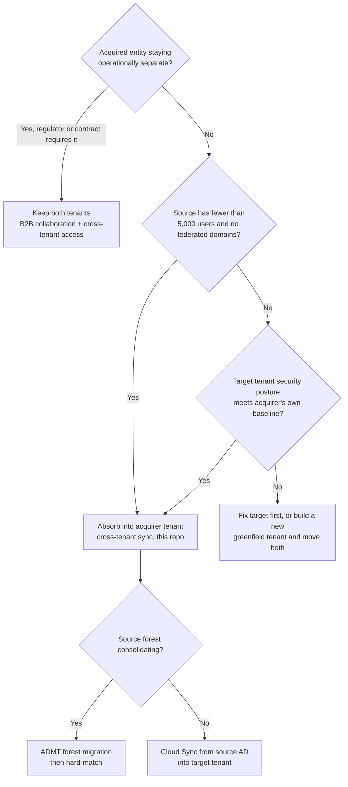

# Architecture and choreography

All diagrams are Mermaid and render natively on GitHub.

## 1. Domain move choreography (the step that causes most outages)

A verified domain can live in only one tenant. Moving `contoso-legacy.example` means a short window where mail for that namespace has no home. This sequence keeps it under 30 minutes.

## 2. Mail coexistence during waves

## 3. Control plane layers in the surviving tenant

## 4. Risk quadrant (where to spend the steering committee's time)

## 5. Decision flow: which consolidation pattern?

