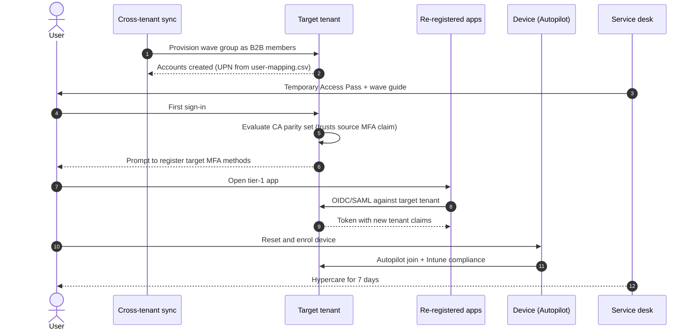
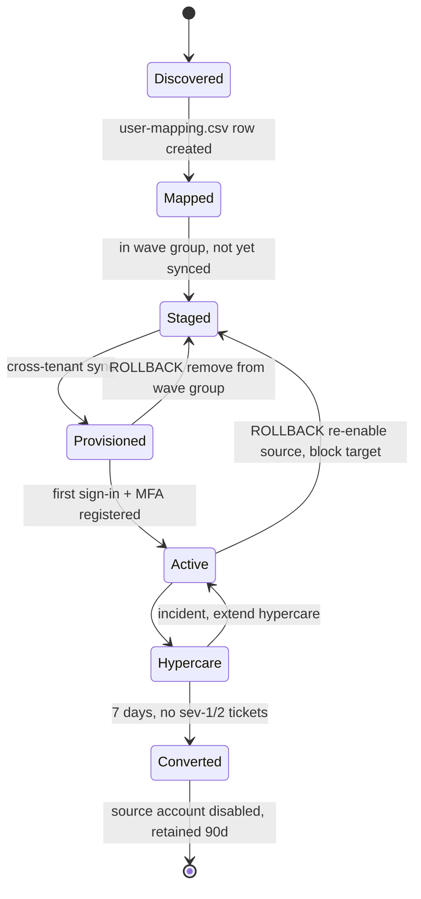

# Cutover runbook (per wave)

Cutover is a Tuesday. Every step has an owner, a time-box and a rollback.

## 1. Day-of sequence

## 2. User state machine and rollback

## 3. Go / no-go checklist (all must be true)

- [ ] `.\scripts\powershell\Test-Preflight.ps1` exits 0 (no unwaived critical findings)
- [ ] CA parity policies in **enforced** state in the target for at least 7 days
- [ ] MFA registration of the wave cohort is at least 98 percent
- [ ] Tier-1 apps in this wave pass pilot-group test in the target
- [ ] Licence headroom covers the cumulative demand (`reports/executive-summary.md`, licensing cliff)
- [ ] Not inside a freeze window (`config/plan.json`)
- [ ] Rollback rehearsed on pilot users within the last 30 days
- [ ] Service desk staffed at 2x normal and briefed

## 4. Cross-tenant sync configuration (source tenant side)

1. In the **target** tenant run `scripts/powershell/Set-CrossTenantSync.ps1 -SourceTenantId <guid> -WhatIf`, review, then rerun without `-WhatIf`.
2. In the **source** tenant: Entra ID, External Identities, Cross-tenant synchronization, Configurations, New configuration.
3. Enter the target tenant ID, test the connection, set provisioning to automatic.
4. Scope to a security group named `wave-<n>-migrate` (assignments, not "all users").
5. Attribute mappings: keep `userPrincipalName` as the rewrite in `reports/user-mapping.csv`; set `employeeId` to the source value; **do not** map privileged role memberships.
6. Provision on demand for the pilot group first, check the audit log, then turn the job on.

## 5. Rollback by layer

| Layer | Rollback | Time to roll back |
|---|---|---|
| Sync | Remove users from `wave-<n>-migrate`, disable job | 5 min |
| Access | Re-enable source sign-in, block target accounts with CA | 15 min |
| Apps | Re-point relying party to source app registration (kept 30 days) | 30 min per app |
| Domain | Reverse choreography, see `architecture.md` section 1 | 30 min |
| Devices | Not reversible without re-provisioning: only move devices in the last hour of a wave | n/a |
